# Making PCBs with the xTool F1 Ultra

A practical, step-by-step guide to making single-sided PCBs with the **xTool F1 Ultra**
fiber laser installed at the **MOBI Lab** (UDESC Joinville). It covers the workflow and the
parameter tuning.

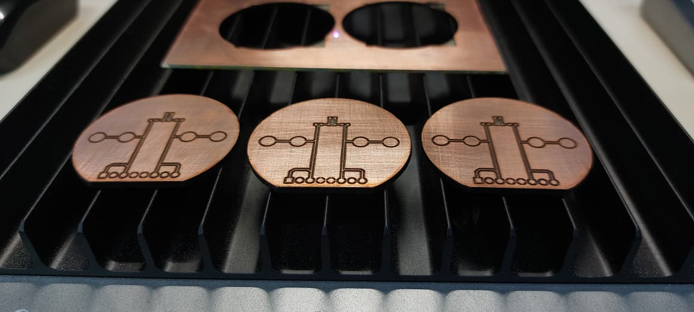

| | |
|---|---|
| **Author** | Paulo Roberto Quispe Cardenas |
| **Difficulty** | Intermediate |
| **Time** | ~2 hours |
| **Software** | xTool Studio 1.5.8 · EasyEDA |
| **Original post** | [Hackster.io, 18 March 2026](https://www.hackster.io/pauloquispec/making-pcbs-with-the-xtool-f1-ultra-b1fffd) |
| **License** | [CC BY 4.0](LICENSE) |

---

## Contents

1. [What you need](#what-you-need)
2. [Quick reference: parameters](#quick-reference-parameters)
3. [Why the fiber laser](#why-the-fiber-laser)
4. [Workflow](#workflow)
   - [Step 0 — Prepare the board](#step-0--prepare-the-board)
   - [Step 1 — Calibration and focus](#step-1--calibration-and-focus)
   - [Step 2 — PCB image generation](#step-2--pcb-image-generation)
   - [Step 3 — Basic cleaning](#step-3--basic-cleaning)
   - [Step 4 — Focused cleaning](#step-4--focused-cleaning)
   - [Step 5 — Cutting](#step-5--cutting)
   - [Step 6 — Post-processing and surface protection](#step-6--post-processing-and-surface-protection)
5. [Scope and limitations](#scope-and-limitations)
6. [Test board](#test-board)
7. [Acknowledgments](#acknowledgments)

---

## What you need

**Materials**

- Single-sided copper-clad board, FR4, 1 oz copper (1.6 mm thick in this guide)
- Sandpaper and a cleaning agent for the copper surface
- Matte black spray paint, used here as a low-cost protective coating
- Tweezers, solder and a soldering iron

**Machines and tools**

- xTool F1 Ultra, using the **Fiber IR** laser
- The **black metal plate** under the board, which protects the machine base
- Multimeter, to check isolation between traces

**Software**

- [EasyEDA](https://easyeda.com/) to design the board and export the artwork
- [xTool Studio](https://www.xtool.com/pages/software) (version 1.5.8 in this guide)

---

## Quick reference: parameters

These are the values that worked on the MOBI Lab machine. Treat them as a **starting
point**: copper thickness, sanding and board flatness all change the result.

| Stage | Laser | Power | Speed | Lines/cm | Frequency | Passes | Other |
|---|---|---|---|---|---|---|---|
| Focus | — | — | — | — | — | — | AutoMeasure on the **back** of the board, then **+1 mm** (20.5 mm in the screenshots) |
| Basic cleaning (Engrave) | Fiber IR | 100 % | 2000 mm/s | 300 | 30 kHz | 15–20 | Bi-directional · **Cross hatch ON** · angle 0°, fixed |
| Focused cleaning (Engrave) | Fiber IR | 100 % | 2000 mm/s | 300 | **40 kHz** | ~10 | Same as basic cleaning, but fewer passes and higher frequency |
| Cutting (Cut) | Fiber IR | 100 % | 4 mm/s | 300 | 30 kHz | 3 | Circle first, then the straight line |

> The engraving screenshot below shows **10 passes at 30 kHz**, a single job inside the
> basic cleaning stage. The 15–20 passes are the total that basic cleaning needed.

---

## Why the fiber laser

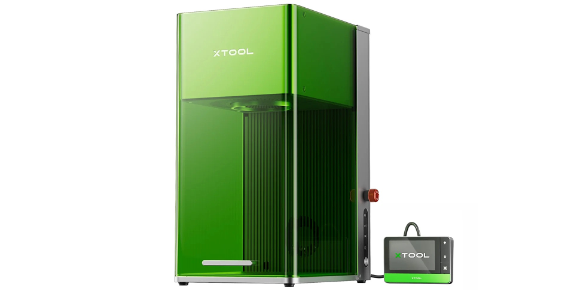

The xTool F1 Ultra has two laser sources on the same platform:

- a **20 W blue diode laser** (~450–455 nm), meant for many common materials;
- a **20 W fiber infrared laser** (~1064 nm), meant for metal engraving, deep engraving,
  embossing and thin metal cutting.

This guide uses the **fiber laser**, because on this machine it is the source built for
metal. That makes it the natural place to start with copper-clad boards.

The physics needs one caveat. In the laser-processing literature, copper generally absorbs
shorter visible wavelengths better than near-infrared light around 1064 nm, so the infrared
wavelength alone does not make copper easier to process. The practical advantage is that
the fiber module is built for metal, and in real PCB tests it gave the most useful
copper-removal behavior.

The workflow has five main stages: **calibration → PCB image generation → basic cleaning →
focused cleaning → cutting**, followed by post-processing.

---

## Workflow

### Step 0 — Prepare the board

- **Sand and clean** the copper surface properly. Oxidation, dirt, fingerprints or uneven
  sanding make copper removal inconsistent and cause defects.
- Keep the board **as flat as possible**. Even small height differences lead to non-uniform
  copper removal across the PCB.
- Always place the PCB **on top of the black metal plate**. The process uses many engraving
  and cleanup passes, and the plate protects the original machine base.

### Step 1 — Calibration and focus

**1.1 Laser alignment calibration.** In xTool Studio, open:

```
Device settings → Parameter settings → Fiber IR and blue-light laser calibration
```

Use the **black calibration sheet** and follow the cross-alignment procedure. The
calibration pattern has two white crosses. On each cross, watch how far apart the blue and
red light references are. This step measures the offset between the two laser references
and corrects it before you process the real PCB.

**1.2 Focus distance with AutoMeasure.** Run **AutoMeasure** on the **opposite side of the
PCB (the FR4 side)**, not on the copper. The copper is reflective, and measuring on the
less reflective back side gave a more stable reference.

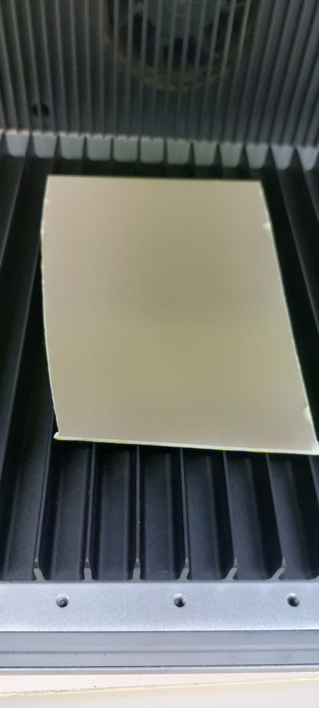

Then **add +1 mm by hand** to the measured distance. This value does not come from a formal
parameter table. It is the offset that gave the best result after trial and error. Another
software or machine parameter may also affect the effective focus, but this correction
worked best on this setup.

### Step 2 — PCB image generation

**2.1 Export from EasyEDA.** Export the board as a PDF/image, **White on Black**, with only
the **Top** layer (plus Background) enabled:

| Export PDF | Top Assembly Drawings — page config |
|---|---|
| 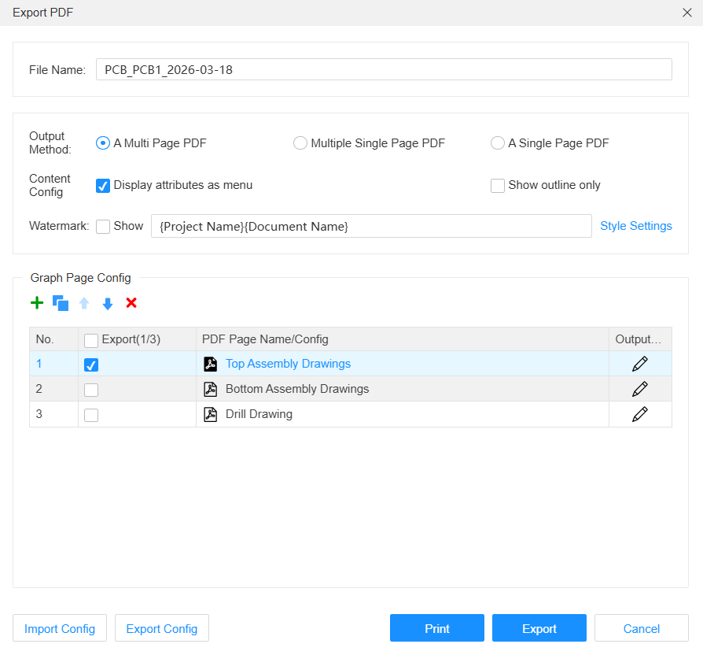 | 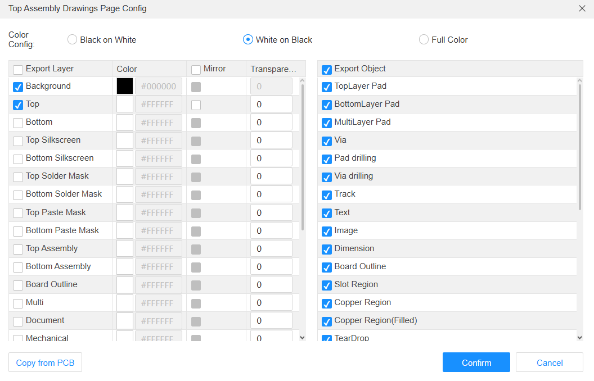 |

In this format the **black** areas are the clearance, the copper the laser has to remove.
The **white** areas keep the traces and pads.

> If your export comes out black on white, import it into xTool Studio and use
> **Adjust → Invert** to get the same result.

**2.2 Scale to real size.** Working from an image instead of vector manufacturing data
makes scaling critical. Use a feature of known size as the reference. In this guide the
board was round with a **44 mm diameter**.

**2.3 Center it.** Check that the whole board fits inside the working area, and place it
**as close to the center as possible**. Laser-marking references and scan-field studies
show that distortion and position error grow toward the edges of the field.

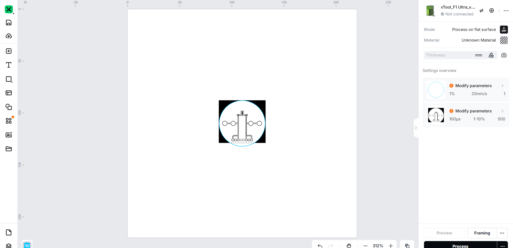

**2.4 Trace.** Use the **Trace** tool to turn the imported image into workable paths. From
here on, the traced geometry is the working pattern, and you no longer need the original
image.

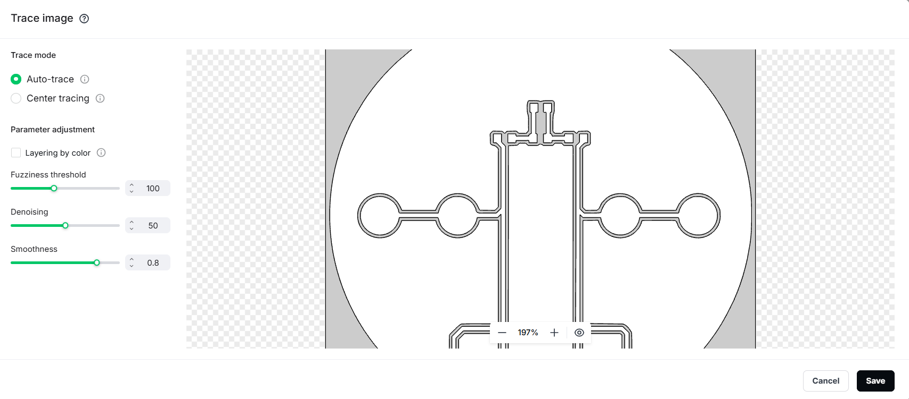

### Step 3 — Basic cleaning

This stage removes **most of the unwanted copper** quickly and aggressively, without
worrying yet about the smallest details. It splits the job into two goals: first bulk
removal, then detail refinement.

- Enable `Engrave → Advanced settings → Cross hatch`. The laser then scans in both
  horizontal and vertical directions, which makes the cleaning more uniform and reduces
  the total exposure time.
- Expect **15–20 passes** in total.

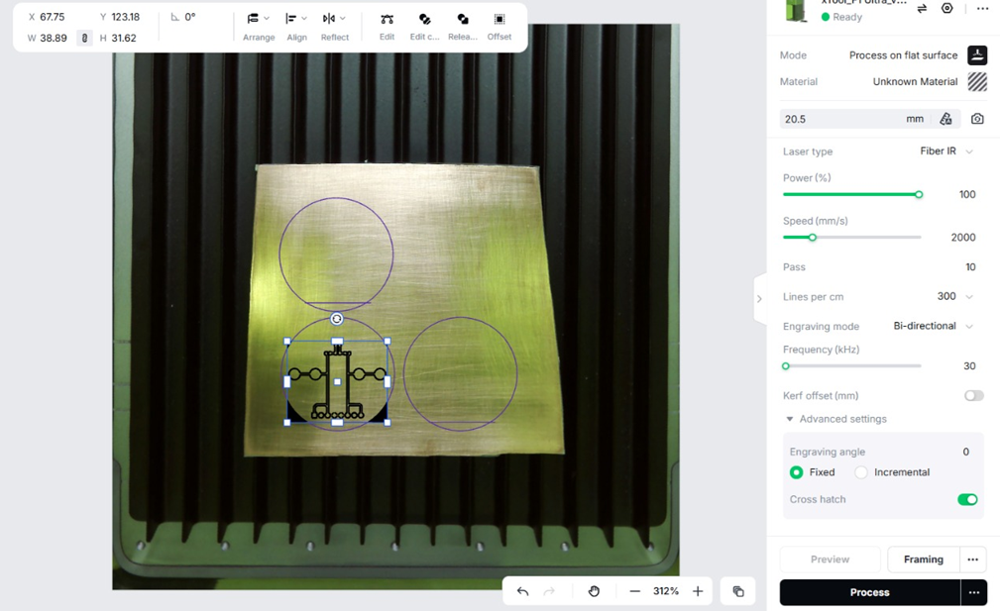

**Visual cue while engraving.** While the laser is still hitting copper, the emission looks
**blue** (sometimes blue-green). Where it has reached the fiberglass it looks **orange**.
The written workflow that inspired these tests describes the same colors, and they tell you
how much copper is left.

▶️ **Video:** [PCB engraving with the xTool F1 Ultra fiber laser](https://www.youtube.com/watch?v=qUFmaFZobCo)

### Step 4 — Focused cleaning

This stage uses **fewer passes (~10)** at a **higher frequency (40 kHz)**, following the
general logic of the reference workflow. The goal is no longer bulk removal. It improves
the isolation areas and the edge definition, and clears the small spots where copper is
still left.

xTool's documentation for the F1 Ultra lists operating ranges of 30–60 kHz in relevant
processing contexts, which agrees with this adjustment.

> **Continuity check.** Before you move on to cutting, use the multimeter to check that
> neighbouring traces are isolated. Do it **only after cleaning the board** with
> **isopropyl alcohol and a brush**: copper and burnt residue left by the laser can bridge
> traces and give a false short circuit.

### Step 5 — Cutting

Treat cutting as a separate stage. A board can have a good copper pattern and still fail
mechanically if the outline is inaccurate or misaligned.

The board in this guide has a custom outline, so it was cut in **two steps: first the
circle, then the straight line**. That order gave more control over the final result.

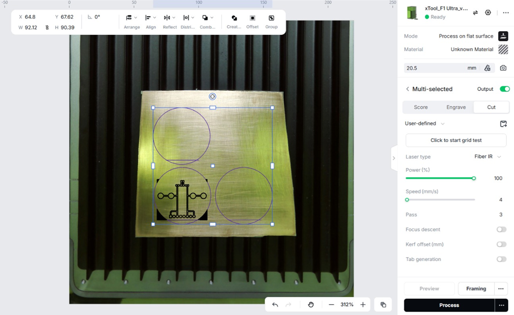

▶️ **Video:** [PCB cutting with the xTool F1 Ultra fiber laser](https://www.youtube.com/watch?v=8e7IpVbUnS0)

### Step 6 — Post-processing and surface protection

**6.1 Clean.** Lightly sand and clean the board again to remove residue.

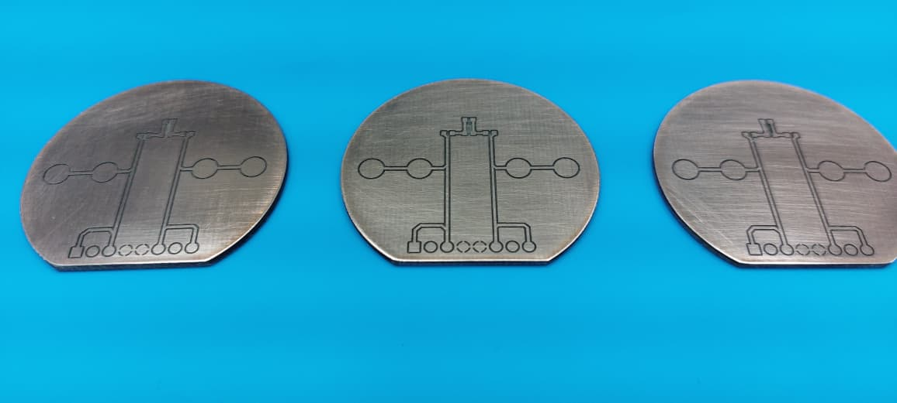

**6.2 Protect.** Spray a layer of **matte black paint** over the surface to protect the
copper from corrosion. It is a simple, low-cost alternative to a UV protective coating or
another dedicated finish.

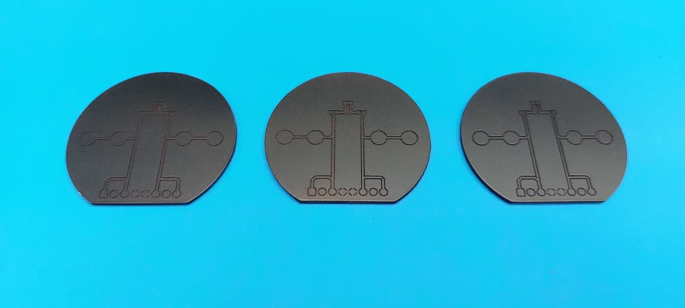

**6.3 Expose the pads.** Scrape the paint off the pads carefully with **tweezers**, so
copper is exposed only where you need electrical contact and solder. It takes patience, but
it keeps the surface protected and the pads ready for assembly.

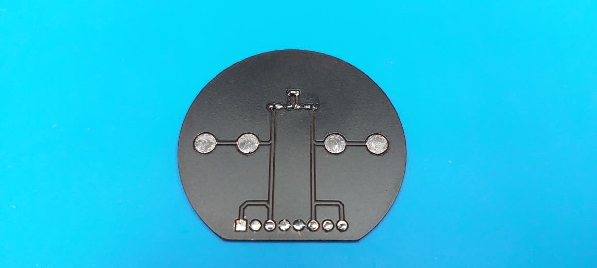

---

## Scope and limitations

This workflow has been tested **only on single-sided (top layer) PCBs**. It has **not** yet
been tested for:

- drilling holes for through-hole components;
- a real silkscreen layer;
- a dedicated UV solder mask or another standard protective finish.

The **number of passes in basic cleaning still needs to be optimized**. Too many passes
damage the board badly: the laser keeps removing material layer after layer, deep into the
substrate, and leaves the board weaker.

Read it as a validated workflow for **copper removal, board shaping and basic
post-processing**, not yet as a complete end-to-end PCB fabrication method.

---

## Test board

The test board is a meaningful case for fine-feature prototyping:

| Property | Value |
|---|---|
| Layers | 1 (top only) |
| Copper | 1 oz |
| Substrate | FR4, 1.6 mm |
| Clearance | 0.3 mm |
| Smallest footprint | 0402 SMD |
| Outline | round, 44 mm diameter |

| Schematic | PCB — top |
|---|---|
| 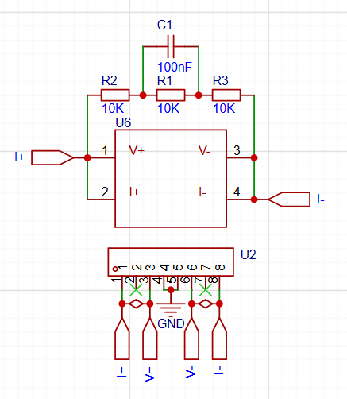 | 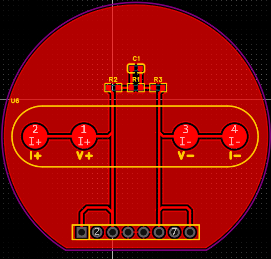 |

---

## Acknowledgments

This workflow was partly inspired by earlier xTool F1 Ultra PCB experiments shared by other
makers, especially:

- Michael Parks (mbparks), [*Making circuit boards with an xTool*](https://gearsofresistance.substack.com/p/making-circuit-boards-with-a-xtool) (written article)
- Daniele Tartaglia, [hands-on YouTube walkthrough](https://www.youtube.com/watch?v=8peIFpolsmk)

The goal here is not to repeat those resources but to document a real test process
step by step: image-based PCB scaling from EasyEDA, AutoMeasure on the back side, a +1 mm
manual offset and a two-stage copper cleanup.

Thanks to the **Laboratório de Sistemas Autônomos e Robótica Móvel (MOBI)**, CCT,
Universidade do Estado de Santa Catarina (UDESC), Joinville, SC, Brazil, for access to the
equipment used in this project. This work is connected to the author's master's research
in biomedical instrumentation at UDESC Joinville.
